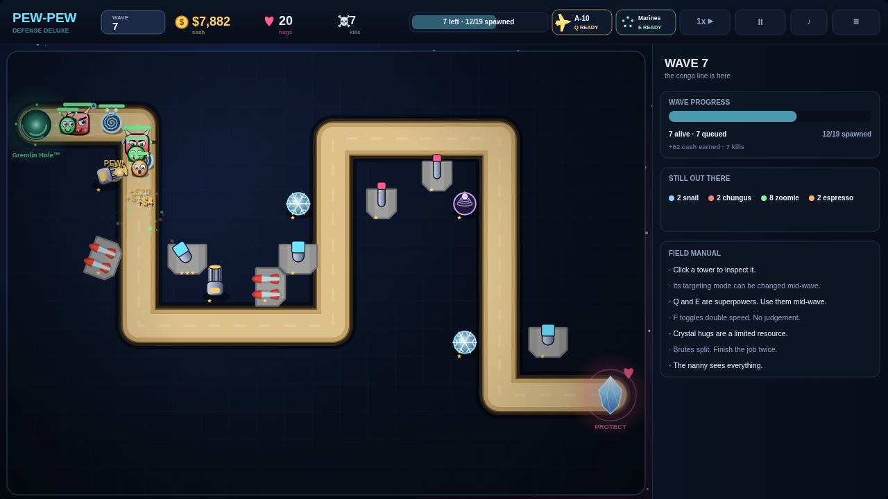

# Sentry Gun: Pew-Pew Defense Deluxe

A tower defense game written in Haskell using Gloss — now with 200% more sparkles and 100% more gremlins!

Protect ur base (pls) from the Zoomie Gremlins pouring out of the gremlin hole.



There are two ways to play:

- **Web port** (`web/`): a self-contained HTML5 build in TypeScript + Canvas, playable in any
  modern browser and packaged for itch.io. This is the version most people should play.
- **Original desktop game** (`src/`): the Haskell + Gloss version that started it all.

## Highlights

- Round-based gameplay with escalating mixed enemy waves
- Starry battlefield, sandy candy road, pulsing portal + beating-heart base
- Googly-eyed turrets with distinct personalities + level stars
- Derpy enemies with faces, health bars, and emotional damage (`!!` when low)
- Neon bullet tracers, starburst muzzle flashes with `PEW!`
- Grid-based tower placement with path/overlap validation
- Tower upgrades aka protein shakes (right-click in shop phase)
- Target Gossip modes: Closest Bozo / Front of Conga Line / Bully the Smoll / Big Chungus First
- Big Brain Mode™ upgrade for global tower-enemy matching
- Funny rotating tips, pause snack-break screen, tragic `BASE GOT SNACC'D!` game over
- Fast-forward espresso mode (`F`) and disco range lights (`R`)

## Enemy Types

- **Zoomie Gremlin (Swarm)**: fragile, fast, low reward. Says "zoom".
- **Espresso Goblin (Runner)**: medium health, very fast, sweating.
- **Dump Truck Chungus (Brute)**: tanky, armored, splits into smaller units on death like bad gossip. Wears a tiny crown.

## Gun Types

- **Pew-Pew Turret** ($50): reliable, like socks. Balanced all-rounder.
- **No-Scope Nanny** ($100): 360 no-scope granny. High range + damage, slow.
- **BRRRT Machine** ($80): caffeine incarnate. Short range, low damage, high fire rate.
- **YEET Cannon** ($150): diplomatic solution. Medium range, high burst.

## How to Play

1. In **Shop Phase**, click a tower button then click the battlefield to adopt it.
2. Press **SPACE** to unleash the wave.
3. During combat, towers shoot automatically (pew pew!).
4. Between rounds, buy towers, right-click to feed them steroids, and tune targeting gossip.
5. Survive as many rounds as possible before base gets snacc'd.

## Controls

- **Mouse Left**: select tower / place tower (click = adopt!)
- **Mouse Right (shop phase)**: upgrade tower under cursor
- **SPACE**: start round (shop) / pause for snacks (combat)
- **T**: cycle target gossip
- **R**: toggle disco range lights
- **F**: toggle espresso speed (1x/2x)
- **Q**: cry quietly

## Web Build

```bash
cd web
npm install
npm run build   # writes a playable site to web/dist/
npm run dev     # dev server with live reload at http://localhost:5173
```

To produce an itch.io upload:

```bash
cd web
./package-itch.sh   # writes docs/pew-pew-defense-deluxe-web.zip
```

The zip contains `index.html` at its root, so it can be uploaded directly as an HTML5
project on itch.io. Store-page copy lives in `docs/itch-description.md`; cover art and
screenshots are in `docs/`.

The web port keeps all its balance tables in `web/src/config.ts` and ships with a headless
balance simulator (`cd web && node sim-run.mjs`).

Web-only extras: two combat superpowers — an **A-10 strafing run** (draw a start and end
point with `Q`) and a **5-marine drop** with five seconds of absurd fire rate (`E`).

## Desktop Build

```bash
stack build
stack run   # run from the project root so assets/kenney/ is found
```

Note: On Linux, you may need OpenGL/GLUT dev libs for Gloss:
`sudo apt install freeglut3-dev libgl1-mesa-dev libglu1-mesa-dev`

Note: On Ubuntu 25.10+ (binutils 2.44+, no `ld.gold`), the repo already works around it:
`-optl-fuse-ld=bfd` is set in `sentry-gun.cabal` + `stack.yaml` (`$everything`). If a fresh
GHC install still fails with `cannot find 'ld'` or `could not execute: /usr/bin/ld.gold`,
patch the GHC settings file (`.../lib/ghc-9.10.3/lib/settings`): replace `ld.gold` with
`ld.bfd` (or symlink it), then rebuild.

## Credits

- Sprites: [Kenney Tower Defense (Top-Down)](https://kenney.nl/assets/tower-defense-top-down) — **CC0** (public domain). See `assets/kenney/License-CC0-Kenney.txt`. Thank you Kenney!
- Built with Haskell + Gloss (+ gloss-juicy for PNG loading).

## License

BSD-3-Clause
